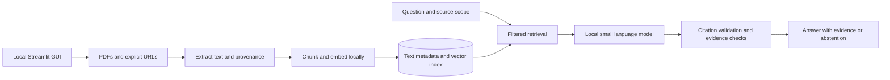

# Source Library — Local SLM & RAG

A local browser GUI for organizing PDFs and optional website and YouTube sources, with an architecture for answering questions using a small language model and retrieval-augmented generation (RAG).

**Status: local RAG prototype.** The GUI and backend support PDF extraction, optional website/YouTube ingestion, local Ollama embeddings, a persistent SQLite index, filtered retrieval, and generated answers with validated citation IDs. Install Ollama and the configured models before indexing. Automated tests use simulated model responses. A live Qwen 3 0.6B synthetic cited-answer compatibility check has also passed; real-document answer quality, complete live retrieval, and external-source availability still need evaluation.

See the [workflow guide](docs/workflow.md) for diagrams, and the [Mac model guide](docs/models.md) for the ten curated model options, memory tradeoffs, and compatibility checks.

For step-by-step GUI instructions, open the [four-page PDF user guide](output/pdf/Source_Library_User_Guide.pdf).

## Features

| Feature | Status |
|---|---|
| Seven-view local Streamlit GUI, including Models | Implemented |
| Automatic browser opening at startup | Configured |
| macOS double-click launcher | Implemented |
| Multiple PDF uploads, file listing, and downloads | Implemented |
| PDF header checks and overwrite prevention | Implemented |
| Website and YouTube URL saving/removal | Implemented; fetching is a separate explicit ingestion step |
| Model catalog, GUI downloads, selection, and memory unloading | Implemented; Ollama installation is separate |
| Shared project model folder | Optional GUI-managed server at `data/models/` |
| Model settings, local persistence, and JSON export | Implemented |
| PDF-only, all-source, and selected-source controls | Implemented and enforced before retrieval |
| Text PDF extraction, local embeddings, persistent indexing | Implemented |
| Website text and timestamped YouTube captions | Implemented; availability depends on the source |
| OCR, audio transcription, and video visual understanding | Not implemented |
| Local model answers, citation validation, abstention, evidence-only mode | Implemented; factual support requires evaluation |

RAG supplies retrieved passages to an existing model; it does not train or fine-tune a model. PDF-only retrieval is the default, with external fetching explicitly enabled during ingestion. Valid citations do not guarantee that a generated claim is supported; inspect the excerpts or use evidence-only mode.

## Requirements

- Python 3.11 or newer, with `venv` and `pip`.
- A modern browser.
- Internet access to install dependencies.
- macOS, Linux, or Windows for the Python GUI; the `.command` launcher is macOS-specific.

The GUI opens without Ollama. **Indexing and retrieval require a running local Ollama service and embedding model; generated answers also require a generation model.** No API keys are required. CPU inference is possible but hardware fit and performance have not been benchmarked. Automated checks run on macOS with Python 3.14; other platforms are not yet verified.

## Quick start

Download or clone this repository and open a terminal in its root folder.

### macOS / Linux

```bash
python3 -m venv .venv
source .venv/bin/activate
python -m pip install -r requirements.txt
python -m streamlit run app.py
```

### Windows PowerShell

```powershell
py -3 -m venv .venv
.\.venv\Scripts\python.exe -m pip install -r requirements.txt
.\.venv\Scripts\python.exe -m streamlit run app.py
```

The GUI attempts to open automatically in your default browser at [http://127.0.0.1:8501](http://127.0.0.1:8501). If automatic opening is blocked, visit the URL manually. Streamlit may show an optional first-run email prompt in the terminal; leave it blank to continue.

Stop the server with **Ctrl+C** in its terminal. Closing the browser tab does not stop the server.

### One-click startup on macOS

After installing dependencies, double-click `start_gui.command` in Finder, or run:

```bash
./start_gui.command
```

The launcher switches to the project folder, uses its `.venv`, and enables browser opening. If executable permissions were lost after downloading a ZIP, restore them:

```bash
chmod +x start_gui.command
```

## Set up the local RAG models

1. Install [Ollama](https://ollama.com/download). Model weights are downloaded separately; the GUI does not install Ollama itself.
2. Launch this GUI and open **Models**. Compare parameter counts, expected disk size, and **estimated** model RAM before downloading.
3. To keep GUI downloads in this repository, click **Start project server and use this folder**. It starts a separate Ollama process at `http://127.0.0.1:11435` with `OLLAMA_MODELS` set to the absolute `data/models/` folder. Existing Ollama libraries are not moved or deleted.
4. Choose an answer model, click **Download selected model**, then **Use selected model**. `qwen2.5:0.5b` is the smallest generation option in the catalog. For embeddings, choose `all-minilm:22m` for the smallest weights or retain `nomic-embed-text:latest` for a larger input window. Activation runs a synthetic compatibility sample before changing settings; failure preserves your previous selection. The original model settings remain unchanged until you explicitly select a model.
5. Add PDFs and **Build / update index**, then open **Ask**. Select **Evidence only** to skip generated synthesis; retrieval still needs the embedding model.

The Models view also supports an existing local Ollama server. Connect through its expander if you prefer your current model library. Its storage folder is configured outside this GUI using `OLLAMA_MODELS`; the API does not report that folder. On macOS the normal default is `~/.ollama/models`. All GUI pulls go to the **active server's** library, so start/connect the desired server before downloading.

### Disk size versus RAM

The catalog's parameter counts, quantization, and expected disk sizes are snapshots linked to the official model pages, checked on 28 October 2026. RAM ranges are app planning estimates at about 8K context, not vendor requirements or measurements. They exclude macOS, browser/Python, your index, and other loaded models. Longer context or concurrent work can exceed them.

After download, the GUI shows the actual **Ollama-reported model size**, which is not necessarily unique additional disk usage because tags can share layers. The loaded-model table separately shows Ollama's reported memory allocation and context. It is not total system RAM; use Activity Monitor to observe memory pressure. **Unload selected model from RAM** releases a loaded model without deleting its files.

Models are stored in Ollama's blobs/manifests format. `data/models/` and `data/model-server/` logs are excluded from Git by the existing `data/` ignore rules. The project server permits one loaded model and one parallel request to limit its memory footprint; swapping between embedding and generation can increase latency. Other Ollama servers are unaffected.

**Stop project model server** stops only the child owned by this running GUI process and preserves downloads. Normal GUI shutdown also attempts to stop that child. A crash can leave it running; the GUI refuses to replace a server it cannot identify as its own on port 11435. Stop such a leftover process manually before starting the managed server again. The startup log is `data/model-server/ollama.log`. Server lifecycle checks use simulated processes in automated tests; live Ollama startup/downloads have not been verified on this machine.

### Optional command-line setup

For a normally running Ollama server on its default port, the original defaults can still be downloaded with:

```bash
ollama pull llama3.2:3b
ollama pull nomic-embed-text
```

These CLI commands target the CLI's configured server, **not automatically the project's port 11435**. For a running project server on macOS/Linux, use `OLLAMA_HOST=127.0.0.1:11435 ollama pull MODEL_TAG` if you choose CLI downloads instead of GUI buttons.

If you installed an earlier version of this GUI, rerun `python -m pip install -r requirements.txt` in its virtual environment and restart it. Downloads can occupy several GB. The app never silently downloads a model or falls back to cloud inference.

## Using the GUI

| View | Available actions |
|---|---|
| Overview | File/URL counts, backend status, and architecture documentation |
| PDF library | Upload/download PDFs, remove one or all, restore removed files |
| Web & YouTube | Save HTTPS page/video links and remove saved links |
| Models | Compare sizes/RAM estimates, download, choose models, manage shared storage, inspect loaded memory |
| Ask | Choose source scope, ask independent questions, inspect citations or retrieve evidence only |
| Index & activity | Build/update the index, optionally fetch external sources, inspect warnings and recent runs |
| Settings | Save model names and context/answer budgets; export settings |

### PDFs

Upload through **PDF library**, or copy files into `data/pdfs/`. Nested PDF folders are included. Refresh the page after external folder changes.

Uploads are limited to **50 MB per file**. Filenames must end in `.pdf`, and content must start with a PDF header. This is an initial check, not full PDF validation. Existing files are never overwritten: rename an incoming file if its name conflicts.

In **PDF library**, choose **PDF to remove** and click **Remove selected PDF**, or tick the confirmation checkbox and click **Remove all PDFs**. Removal immediately excludes files from answers and moves them to `data/removed-pdfs/`, which is ignored by Git. The **Restore removed PDFs** expander restores individual files to their original relative locations without overwriting existing files. Build/update the index after restoration. Removal preserves old index records as inactive history; it is not permanent data erasure. Model downloads and saved web links are unaffected. This feature supersedes the older PDF guide's instruction to remove PDFs manually.

Uploading does not index a file. Open **Index & activity** and build the index afterward. Textless pages produce warnings and a completely textless PDF fails visibly. OCR, image interpretation, and layout-aware table processing are not implemented.

### Website and YouTube links

Use **Web & YouTube** to select the source type and save an HTTPS URL. Supported YouTube video URLs are checked and normalized to watch URLs. Duplicate stored URLs are not added again.

Saving links does not fetch content. In **Index & activity**, explicitly enable external fetching to ingest pages and available captions. Website fetching supports public HTTPS pages, not login or JavaScript-rendered content. Captions may be missing or inaccurate and do not capture visual-only information.

### Model settings

Use **Models** for downloads and model selection. Use **Settings** for manual generation/embedding model names and context/answer budgets. Changing manual model names runs a synthetic compatibility check before saving and can load a model into RAM. Saving budgets alone does not run inference. Changing the embedding model or its installed digest requires rebuilding the index. Use **Check local model setup** to verify installed models.

## Configuration and local data

| Location | Purpose | Included in Git? |
|---|---|---|
| `.streamlit/config.toml` | Localhost binding, browser opening, theme, upload limit, disabled usage telemetry | Yes |
| `config/settings.example.json` | Default application settings | Yes |
| `config/sources.example.json` | Empty source manifest and transcript language defaults | Yes |
| `config/settings.json` | Personal settings created when saved | No |
| `config/sources.json` | Personal links created when changed | No |
| `data/pdfs/` | Your documents | Only the empty `.gitkeep` placeholder |
| `data/index/` | SQLite source metadata, extracted passages, embeddings, and ingestion history | No |
| `data/removed-pdfs/` | Recoverable copies of PDFs removed through the GUI | No |
| `data/models/` | Shared project model weights when using the managed project server | No |
| `data/model-server/` | Project Ollama server logs | No |
| `.venv/` | Installed Python environment | No |

The GUI uses example JSON files until local configuration files exist. Keep examples generic and save personal choices through the GUI. The PDF library currently uses the fixed `data/pdfs/` folder; editing `pdf_directory` in JSON does not redirect the GUI. Chunk and context budgets currently use conservative UTF-8 byte counts instead of model-specific tokenization; see the architecture for details. The default similarity threshold is uncalibrated and adjustable in Settings.

### Privacy and deployment

The app stores files, URLs, settings, extracted text, and embeddings locally. Ingestion contacts supplied external sources only when explicitly enabled. Model requests use the configured loopback Ollama service; cloud-backed models are rejected. Project configuration disables Streamlit usage telemetry. Application data is not encrypted by this project.

The server binds to `127.0.0.1`. Authentication, multi-user isolation, and production hosting are not implemented. Keep it local for now. Future remote deployment needs authentication, authorization, upload protections, and source access controls.

The local model backend keeps document processing on the machine; model downloads and external-source ingestion still require network access. See the [architecture](docs/architecture.md) for grounding limitations and network-fetch safeguards.

## Architecture

The GUI is connected to the ingestion, retrieval, and answer-generation pipeline:



| Component | Implementation |
|---|---|
| GUI | Python + Streamlit; implemented |
| Workspace persistence | Python filesystem + JSON; implemented |
| PDF extraction | pypdf, with physical page provenance |
| Website extraction | Validated HTTPS fetcher + Trafilatura |
| YouTube ingestion | youtube-transcript-api captions with time intervals |
| Model serving | Local Ollama embeddings and structured generation |
| Initial model candidates | `llama3.2:3b`, `nomic-embed-text`; unbenchmarked |
| Prototype search | SQLite text/JSON vectors; Python cosine similarity + BM25 + reciprocal rank fusion |
| Larger-scale vector store | Qdrant if measurements justify it; optional |

Python dependencies are listed in `requirements.txt`. Install Ollama and pull models separately. Model licenses, hardware fit, and answer quality must be checked for your use case.

Read [docs/architecture.md](docs/architecture.md) for provenance, incremental ingestion, source isolation, grounding controls, module boundaries, and acceptance criteria.

## Repository layout

```text
.
├── .gitignore
├── LICENSE                      # MIT license
├── .streamlit/config.toml
├── README.md
├── app.py                       # Seven-view Streamlit GUI
├── requirements.txt             # GUI dependency range
├── start_gui.command            # macOS launcher
├── config/
│   ├── settings.example.json
│   └── sources.example.json
├── data/pdfs/.gitkeep            # Private inputs ignored
├── docs/
│   ├── architecture.md
│   ├── workflow.md               # Source preparation, ingestion, and question-answering diagrams
│   └── models.md                 # Mac candidates, RAM estimates, compatibility
├── src/
│   ├── __init__.py
│   └── rag/
│       ├── __init__.py
│       ├── workspace.py          # Upload checks, URLs, JSON persistence
│       ├── extraction.py         # PDF pages, website text, timed captions
│       ├── chunking.py           # Overlapping passages with provenance
│       ├── models.py             # Ollama inference, downloads, compatibility
│       ├── answers.py            # Shared cited-answer schema and validation
│       ├── catalog.py            # Curated metadata and estimated RAM
│       ├── model_ui.py           # Models GUI
│       ├── model_server.py       # Optional project-owned Ollama process
│       ├── store.py              # Transactional SQLite persistence
│       └── engine.py             # Ingestion, filtered retrieval, citations
└── tests/
    ├── test_workspace.py
    ├── test_rag.py
    ├── test_gui.py
    └── test_model_management.py
```

## Development and testing

From the repository root, with the virtual environment active:

```bash
python -m unittest discover -s tests -v
python -m compileall -q app.py src tests
```

Tests use generated PDFs, real extraction/SQLite, fixture webpage/caption responses, and a deterministic mocked model client. Coverage includes PDF-only isolation, selected-source filtering, incremental updates, deletion, failed-update preservation, model digest changes, invented citation rejection, abstention, and the GUI Build Index → Ask flow. Model-library tests additionally exercise all catalog adapters, synthetic compatibility probes, failed-activation preservation, model-aware chunk limits, streamed pull success/failures, GUI download/selection, role checks, shared-folder server startup configuration, occupied-port refusal, and owned-child cleanup, using mocked HTTP/processes. They do not establish live download/server behavior, actual RAM use, real-model factual support, prompt-injection robustness, live URL availability, or throughput.

For a GUI navigation smoke check in a macOS/Linux shell:

```bash
python - <<'PY'
from streamlit.testing.v1 import AppTest

app = AppTest.from_file("app.py", default_timeout=30).run()
assert not app.exception, app.exception
for page in ["PDF library", "Web & YouTube", "Models", "Ask", "Index & activity", "Settings"]:
    app.sidebar.radio[0].set_value(page).run()
    assert not app.exception, app.exception
print("All seven GUI views passed")
PY
```

On Windows, save the Python body to a temporary `.py` file in the repository root and run it with the virtual-environment Python.

`requirements.txt` specifies a version range, not an exact environment lock. Record tested versions when preparing reproducible releases.

## Troubleshooting

| Problem | Action |
|---|---|
| Browser does not open | Visit the printed URL; ensure startup does not pass `--server.headless=true`. |
| Port 8501 is occupied | Stop the existing server, or launch with `python -m streamlit run app.py --server.port 8502`. |
| `No module named streamlit` | Install requirements using the same Python environment that starts the app. |
| Launcher reports missing environment | Create `.venv` in the project root and install requirements there. |
| Filename already exists | Rename the incoming file; overwrites are deliberately prevented. |
| Configuration cannot be read | Fix local JSON syntax, or back up and move the affected local JSON file to restore example defaults. |
| Sources are not searchable | Build/update the index; inspect failures and confirm question source scope. |
| Ollama connection/model error | Start the local Ollama service, pull the configured models, and use Check local model setup. |
| Embedding model/digest mismatch | Build/update the index after changing or updating the embedding model. |
| Port 11435 is occupied | A separate or leftover process is using the project port. Stop it manually, or connect to an existing local server; the GUI will not replace an unknown process. |
| Model catalog still shows no installed weights | Check the active server. The default Ollama library and optional project library are separate. |
| Unexpected abstention | Inspect source scope, indexed text, and similarity threshold; thresholds need calibration. |

## Preparing for GitHub

The repository includes source code, setup instructions, configuration examples, tests, and ignore rules. Publishing is a separate step; no remote repository or push is created by these instructions.

Inspect what will be included before committing:

```bash
git status --short
git add .
git diff --cached --stat
git diff --cached
```

Confirm that staged files contain no private PDFs, saved URLs, personal settings, credentials, or generated indexes. `.gitignore` excludes normal local-data locations, `.venv`, `.env`, Python caches, and SQLite files. Ignore rules do not remove already tracked files or protect sensitive content saved elsewhere.

Commit the reviewed files:

```bash
git commit -m "Add local RAG GUI and architecture"
```

Create an empty GitHub repository and follow its **push an existing repository** instructions using your actual remote URL and current branch. Use shareable sample documents for demonstrations.

Suggested repository description:

> Local Streamlit GUI for PDF, website, and YouTube source management, with a source-grounded SLM/RAG architecture. Local Ollama RAG backend with citations and source filtering.

## Roadmap

- [x] Architecture and example configurations.
- [x] Interactive GUI and automatic browser launch.
- [x] PDF uploads/downloads, link management, and saved settings.
- [x] Ten small Mac model choices, compatibility checks before activation, model-specific input limits, streamed downloads, shared storage, and memory-unload controls.
- [x] Persistence/validation tests and GUI navigation smoke check.
- [x] PDF extraction with page provenance and empty-page warnings.
- [x] Local embeddings, persistent index, and incremental synchronization.
- [x] Filtered semantic/keyword retrieval with PDF-only isolation.
- [x] Ollama integration, validated citation IDs, evidence excerpts, and abstention.
- [x] Optional website extraction and timestamped YouTube captions.
- [x] Source lifecycle tests and synchronous ingestion progress reporting.
- [ ] Real-model grounding evaluation, online integration checks, and hardware benchmarks.
- [ ] OCR, table-aware extraction, and deployment options as needed.

## Contributing

See the [frontend and backend audit](docs/audit.md) for verified behavior, regression coverage, and remaining live-model checks.

Keep changes focused, describe user-visible behavior, and run relevant checks. Keep model/retrieval logic independent of the GUI. Do not label planned backend features as implemented or substitute simulated answers for unavailable functionality. Do not commit private inputs or credentials.

## License

This project's code and documentation are licensed under the [MIT License](LICENSE). Copyright (c) 2026 Sijan Regmi. Dependencies, models, and ingested source content retain their own terms; the project license does not relicense them.
