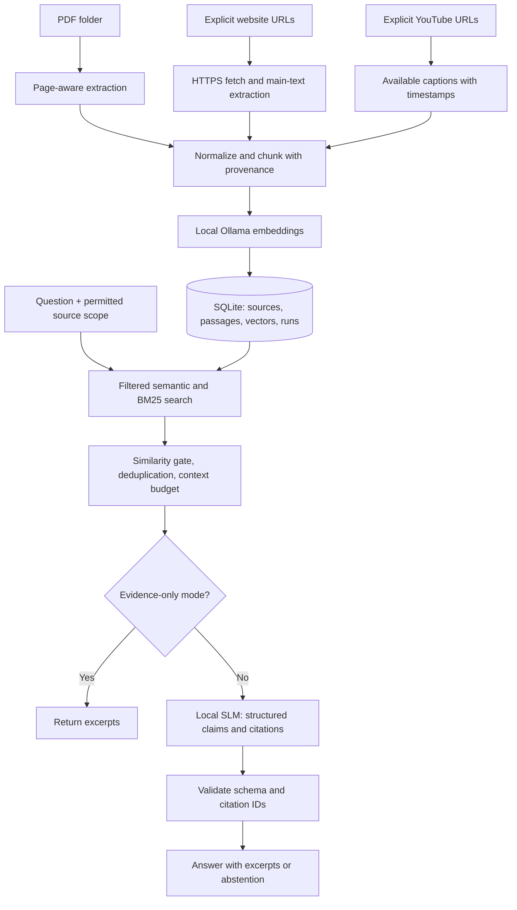

# Architecture

## Implementation status

The local RAG pipeline is implemented and connected to Streamlit. Install the Python requirements and local Ollama models before ingestion. Deterministic tests exercise real PDF extraction, SQLite persistence, source filtering, retrieval, citation validation, and GUI actions using a model double. Real-model quality and live third-party source availability have not been validated on this machine.

## Objective and boundaries

Answer questions from an explicitly selected collection: PDFs by default, with optional supplied website pages and YouTube captions. RAG retrieves passages for a pretrained small language model; adding sources does not train the model.

Source selection is enforced in code before ranking or context assembly. No browser/search tools are available during answering. The local Ollama endpoint is restricted to loopback, installed models are checked, and cloud-backed models are rejected. The model still has prior knowledge: prompts and valid citation IDs cannot prove that every generated claim is supported. Inspect evidence or use evidence-only mode; factual-support evaluation remains necessary.

## Data flow

## Modules

| Module | Responsibility |
|---|---|
| `app.py` | Seven-view GUI, explicit ingestion, query scope, model check, evidence display |
| `src/rag/workspace.py` | PDF uploads/listing, URL syntax validation, atomic local JSON writes |
| `src/rag/extraction.py` | PDF pages, safe website fetching, caption grouping |
| `src/rag/chunking.py` | Overlapping Unicode-safe passages with source locations |
| `src/rag/models.py` | Local Ollama transport, digest/vector checks, pulls, status, compatibility probes, adapters, and unloading |
| `src/rag/answers.py` | Shared claim/citation schema and validation for answers and compatibility samples |
| `src/rag/catalog.py` | Curated model metadata, links, and explicitly estimated RAM ranges |
| `src/rag/model_ui.py` | Model comparison, download/selection, shared storage controls, installed and loaded views |
| `src/rag/model_server.py` | Optional owned Ollama process on port 11435 with project storage |
| `src/rag/store.py` | Transactional SQLite persistence and ingestion history |
| `src/rag/engine.py` | Settings validation, source discovery, ingestion, hybrid retrieval, answer validation |

The core does not depend on Streamlit. There is no API service, task queue, authentication, or multi-user authorization yet. Ingestion runs synchronously with GUI progress indicators.

## Ingestion

### PDFs

Read the fixed `data/pdfs/` directory recursively, rejecting paths that resolve outside it. pypdf extracts each page independently; citations use one-based physical page numbers, which may differ from printed labels. Empty pages generate warnings. A completely textless PDF fails visibly. Password-protected PDFs requiring a password fail. OCR, layout-aware table/equation processing, and image interpretation are not implemented.

File hashes allow unchanged PDFs to skip extraction/embedding when the processing fingerprint also matches. PDF uploads enforce a 50 MB limit, but files placed directly on disk are not size-limited by the uploader. This is a trusted local prototype, not a sandbox for hostile PDF parsing.

### Websites

External fetching requires checking **Also fetch saved website and YouTube sources** during ingestion. Only the supplied page is fetched; no link crawling, login, JavaScript browser rendering, or automatic web search occurs.

HTTPS is required on port 443. Each request and redirect is validated. DNS results must all be public IPv4/IPv6 addresses, and the connection is pinned to a validated address while TLS verifies the original hostname. Fetches have timeouts, at most five request hops, a 5 MB response limit, and HTML/plain-text content-type checks. Environment HTTP proxies are not used by this fetcher. Compressed responses are rejected. Trafilatura extracts main text. The requested URL and final fetched URL are retained; titles and HTML canonical-link metadata are not extracted separately.

Use only content you can access appropriately. The fetcher does not implement a crawler policy engine or robots.txt parser. Hosted deployments should additionally enforce outbound network restrictions and resource limits.

### YouTube

Validate supported video URLs and extract the video ID. `youtube-transcript-api` fetches available captions in the configured language preference list. Network requests have timeouts and disable environment proxy inheritance. Adjacent caption segments are grouped into roughly 45-second units before chunking. Each chunk preserves its group's interval; that interval may be broader than the particular text chunk.

The SDK manages requests to YouTube and its caption endpoints; the custom website fetcher does not handle those requests. Videos can fail because of unavailable captions, languages, access restrictions, or platform blocking. Audio downloading, speech recognition, and visual frame understanding are not implemented.

### Chunking and fingerprints

Whitespace is normalized and passages stay within their PDF page, website unit, or caption group. Current chunk and context budgets use **UTF-8 byte counts as a conservative token proxy** for the intended byte-token models, rather than a model-specific tokenizer. Thus the legacy `chunk_target_tokens=400` means at most 400 UTF-8 bytes of passage text, and overlap is at most 60 bytes. These settings yield relatively short passages, especially for multilingual text. When using MiniLM, the effective target is capped at 224 bytes to respect its short embedding input, and overlap is capped at one third of the effective target. This splits all source text rather than truncating it. Long MiniLM search questions are shortened with a warning while generation retains the full question. Model-specific tokenization and paragraph-aware splitting are future improvements.

The processing fingerprint includes pipeline version, extraction package versions, language settings, chunk settings, and embedding model name plus installed digest. A changed model digest invalidates retrieval against the old index until re-ingestion. Remote pages/captions are fetched on every explicit external update; embedding is skipped if extracted content and fingerprint remain unchanged.

### Replacement and removal

Source metadata, passage text, and vectors are replaced in a single SQLite transaction after successful extraction/embedding. Failed replacements retain the previous content and expose an error. Retrieval displays warnings when using retained stale content or a PDF changed since indexing.

Synchronization marks sources absent from the folder/manifest inactive without deleting their history. Query scope also intersects the current folder/manifest, excluding removed sources immediately, before a synchronization run. Changing chunk settings does not invalidate existing retrieval automatically; rebuild to apply the new chunk policy.

## Storage

One database, normally `data/index/rag.sqlite3`, holds:

| Table | Stored fields |
|---|---|
| `sources` | Stable source ID, kind, locator, content hash, processing fingerprint, model identity, update time, active flag, error, warnings |
| `chunks` | Row ID, source ID, text, page/URL/time metadata, normalized embedding vector as JSON |
| `runs` | Run ID, finish time, per-source results |

The source ID hashes source type and locator. Chunk row IDs are internal; answers receive short per-query citation numbers. There is one active content version per source, not a complete historical archive. Source failures retain prior content; run logs record source-level failures. A model-setup failure before source processing is shown directly in the GUI.

Cosine similarity and BM25 are calculated in Python over the permitted passages, then fused with reciprocal rank fusion. This implementation does not use NumPy, SQLite FTS5, or an approximate-nearest-neighbor database. Full scans are appropriate for a small prototype; benchmark corpus growth before choosing a dedicated vector index. Database schema migrations are not yet provided.

## Retrieval and generation

1. Resolve **PDF only**, **All sources**, or selected source IDs from the current folder/manifest.
2. Intersect with active indexed sources before reading/ranking passage vectors. Reject incompatible embedding model identities, even when dimensions match.
3. Embed the independent question with the same local embedding model. Questions are limited to 2,000 UTF-8 bytes.
4. Rank by cosine similarity and BM25; combine top candidates using reciprocal rank fusion.
5. Apply the configurable minimum cosine similarity, deduplicate exactly identical passages within a source, and enforce passage count and context byte budgets. Similar passages can contain conflicting numbers or facts, so they are retained. Only fields actually supplied to generation count toward the passage budget. The default 0.35 similarity threshold is uncalibrated; it does not establish answerability.
6. With no retained passages, abstain without calling generation. Evidence-only mode returns the actual passages without generated synthesis; embeddings still require Ollama.
7. Otherwise, give the question and numbered evidence to the local generation model with a structured JSON schema. Evidence instructions are explicitly treated as untrusted data.
8. Validate `status` and a nonempty list of `claims` for answered output. Every claim needs text and integer citation IDs from the supplied evidence. Abstention requires an empty claims list. Retry malformed/invalid output once, then abstain.
9. Display generated claims separately from application-generated citation markers and the real source excerpts. PDF pages and video timestamp links come from indexed metadata, not model text.

There is no automated entailment checker. A valid citation can still be irrelevant to the claim. Prompt-injection resistance and real-model factual support require evaluation; this implementation does not guarantee hallucination-free answers. Questions are independent, without conversational memory.

## Local setup and limitations

Install Ollama separately. The Models view can start a project-owned local service, stream downloads, and select generation/embedding models; an existing local service is also supported. Defaults are `llama3.2:3b` for generation and `nomic-embed-text` for embeddings. Check installation in **Settings**. Names are starting candidates, not measured hardware recommendations.

Model APIs run locally with request timeouts and no redirect/cloud fallback. Changing a tag's installed digest requires reindexing. Do not change model installations concurrently with ingestion or queries. Larger context budgets can increase model memory requirements.

Automated tests use generated PDFs, real extraction/SQLite, and deterministic mocked model responses. Website and YouTube extraction tests use fixture responses. They verify control flow and isolation, not real-model quality, online availability, or throughput. A labeled real-model evaluation set and hardware benchmarks remain future work.

## References

- [Ollama embeddings API](https://docs.ollama.com/api/embed)
- [Ollama API and structured outputs](https://github.com/ollama/ollama/blob/main/docs/api.md)
- [youtube-transcript-api](https://github.com/jdepoix/youtube-transcript-api)
- [pypdf text extraction](https://pypdf.readthedocs.io/en/stable/user/extract-text.html)
- [Trafilatura documentation](https://trafilatura.readthedocs.io/)

## Model library and shared storage

The Models view offers eight generation models (Qwen 2.5 0.5B/1.5B/3B, Qwen 3 0.6B/1.7B, Gemma 3 1B, and Llama 3.2 1B/3B) plus Nomic and MiniLM embeddings. See [models.md](models.md) for metadata, estimates, and caveats. The catalog is a static, dated snapshot with official source links, rather than an automatic online registry query. Installed parameter/size metadata comes from `/api/tags`; loaded allocation/context comes from `/api/ps`. Catalog RAM ranges are estimates, not observed process RAM. A download uses streamed `/api/pull` events, displays current-layer progress, and requires a success event plus a verified local installed tag before reporting completion. It does not automatically select the model.

Selecting an installed model checks its role and runs a synthetic sample before saving settings: a valid cited structured answer for generation, or finite document/query vectors with matching dimensions for embeddings. Failed checks do not change settings. A standalone check button tests without activation, and changed manual names in Settings are checked as well. Qwen 3 adapters disable thinking. These samples do not validate real-document quality. Embedding changes still require reindexing and similarity-threshold calibration. Cloud-backed models remain disallowed. Catalog-only downloads avoid arbitrary registry names; existing local models outside the catalog can be selected after capability checks. Unloading uses `keep_alive=0` and preserves on-disk files.

The optional project server is a child process bound to `127.0.0.1:11435`, with `OLLAMA_MODELS` set to the absolute `data/models/` folder, cloud features disabled, one loaded model, and one parallel request. It never replaces the default Ollama service. Logs go in `data/model-server/`. Closing the browser tab leaves the GUI/server running; stopping the Python GUI normally attempts to terminate its owned child. A process registry is kept only in memory, so a crash/restart can require manually stopping a surviving child before the GUI will manage that port again. No process is adopted or stopped from a file-saved PID. An occupied unknown port is rejected.

The existing-server option cannot verify its physical storage folder from Ollama's public API. It explicitly labels the folder as externally managed. Switching to project storage does not migrate old weights; downloads use the currently connected server. Tests mock download responses and child-process startup; live downloads, live lifecycle behavior, and hardware-specific RAM remain unverified.
