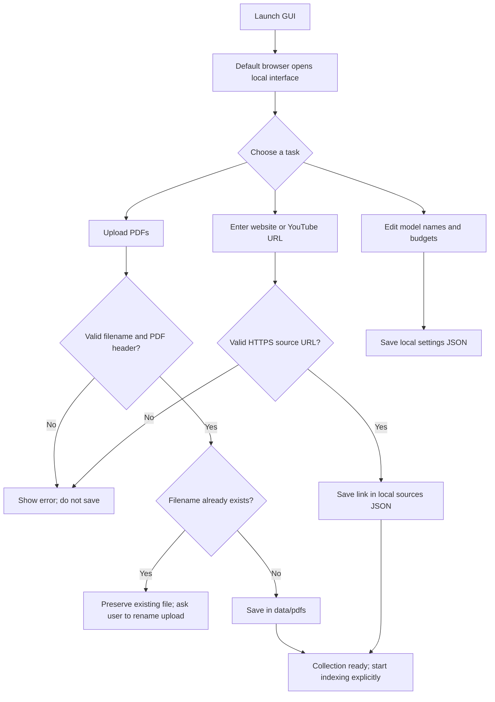
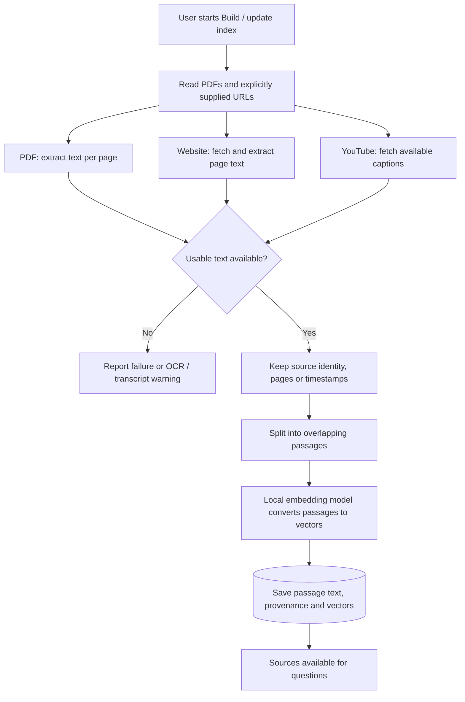
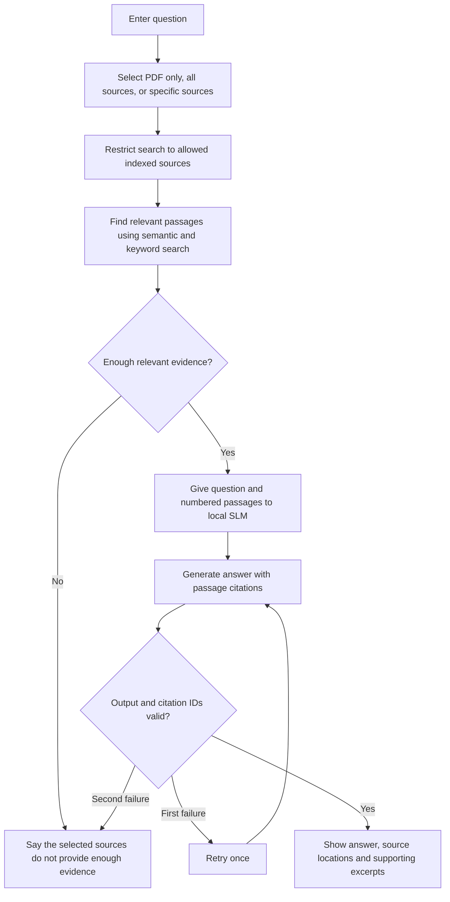
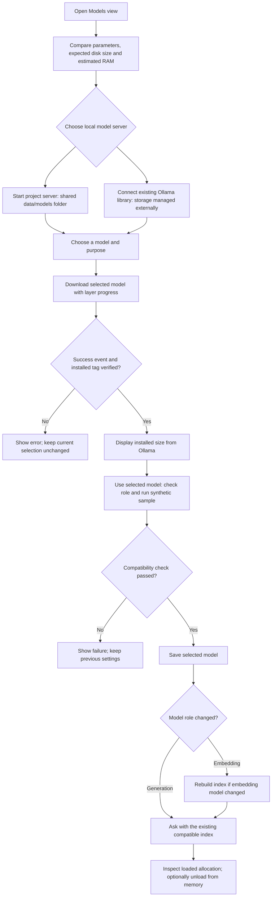

# How Source Library works

The GUI and RAG backend are implemented. Install Ollama, then use the Models view to start/connect a local server, download, and select the configured models before indexing. Uploading and indexing remain separate actions. These Mermaid diagrams render directly on GitHub. Automated tests use mocked models; live model quality and external availability still require validation.

## 1. Available today: prepare your collection

1. Start the app using `start_gui.command` on macOS, or `python -m streamlit run app.py` from the project root.
2. In **PDF library**, upload documents or inspect/download existing PDFs. Existing files are not overwritten.
3. In **Web & YouTube**, optionally save links. This does not download source content.
4. In **Models**, compare model sizes and RAM estimates. Optionally start the project server to store all downloads in `data/models/`, then download/select one answer model and one embedding model. Downloading does not load the model into memory. In **Settings**, adjust answer/context budgets separately.
5. In **Index & activity**, click **Build / update index**. Optionally enable external fetching. Then open **Ask**, select your source scope, and submit a question. **Evidence only** returns passages without generated synthesis.

Uploaded PDFs and local JSON persist after the app closes. Closing the browser does not stop the Python server; use Ctrl+C in its terminal.

## 2. Ingest sources into searchable knowledge

Ingestion is the preparation stage. It runs after sources are added or changed, rather than reading every document again for each question.

- **Extraction** turns source content into text. Scanned PDFs need OCR; unavailable captions produce a visible failure. Video images are not covered by captions.
- **Provenance** records where each passage came from: PDF filename/page, webpage URL, or video timestamp.
- **Chunking** breaks long text into manageable passages while preserving source locations.
- **Embeddings** represent passages as numeric vectors for meaning-based search. This is indexing, not model training.
- **Storage** keeps the text and locations alongside the vectors. Unchanged sources can be reused; changed sources must replace their old indexed version safely.

The implementation uses local embeddings and SQLite storage. Website and YouTube acquisition need internet access. Automatic web search and following arbitrary page links remain disabled by default.

## 3. Answer a question

**PDF only** is the default. The source restriction is enforced before retrieval and context assembly, so a saved website cannot supply an answer in PDF-only mode. The answering stage has no browsing tools.

The local SLM synthesizes the retrieved evidence. It still has pretrained knowledge, so a prompt and valid citation IDs alone cannot guarantee factual support. Claim-support evaluation is required. Evidence-only mode returns retrieved excerpts without generated synthesis.

## Example of the intended experience

This is an illustrative example, not a measured result from a live model:

1. You upload `handbook.pdf` containing a passage on physical page 12: “Employees receive 15 days of annual leave.”
2. You build the index. That passage is stored with the file identity and page number.
3. You choose **PDF only** and ask: “How many annual leave days are provided?”
4. Retrieval finds the passage. The intended answer is: “Employees receive 15 days of annual leave. [handbook.pdf, page 12]”, with the passage available to inspect.
5. If you ask for a policy absent from the selected documents, the intended result is an insufficient-evidence response rather than an invented answer.

The model weights do not change when a PDF is added. The searchable index changes. This lets the collection grow without retraining a language model.

## What happens when a source changes?

| Action | Result |
|---|---|
| Add a PDF | Save/list the file; run ingestion to make its passages searchable |
| Add a URL | Save the link; enable external fetching during ingestion |
| Change a PDF on disk | Re-ingestion detects the change and replaces indexed passages; queries warn about the old version until then |
| Remove a URL or PDF | Queries exclude it immediately; synchronization marks its index inactive |
| Change embedding model or installed digest | Rebuild embeddings before querying selected incompatible sources |
| External fetch or embedding fails | Show the error and preserve the previous usable source version with a warning |

For technical details and acceptance tests, see [architecture.md](architecture.md). For installation and launch instructions, see the [README](../README.md).

## Model selection and download workflow

RAM figures shown before download are estimates for about 8K context. Installed disk size and loaded allocation are separate server-reported values. Unloading preserves downloads. The project folder, model server logs, and index are excluded from Git.
